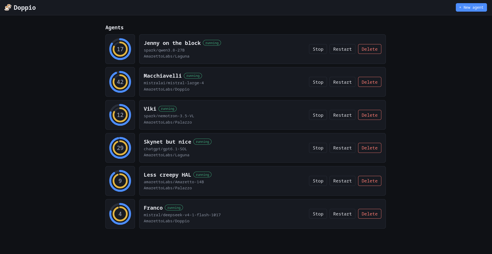

<p align="center">
  
</p>

<h1 align="center">Doppio</h1>

<p align="center">
  <a href="https://github.com/AmarettoLabs/Doppio/actions/workflows/ci.yml"></a>
  <a href="LICENSE"></a>
</p>



AmarettoLabs runs a lot of custom coding agents manually, each one a container
with a persona, a model token, a git account and a poll loop. **Doppio** was
born out of the need to automate that work for the simplest of our agents:
today it handles around 20% of them.

Doppio is a web portal to create, deploy, track and manage those agents. Each
agent gets a name, a persona, a standing task, a model (OpenAI / Anthropic /
Mistral or any custom `provider/model` + token), email addresses, and its own
GitHub/GitLab account (login + token + repos to watch). One click deploys it as
a Docker container; the worker polls GitHub/GitLab for the work its owner
hands it (review requests, mentions, assigned issues and PRs), does it through
its model (with a tool loop: shell, file edits, opening PRs), and streams
everything live to the portal.

> **Security:** the manager drives the host Docker daemon and agents run a
> shell steered by whoever can comment in their repos. Read
> [SECURITY.md](SECURITY.md) before exposing the portal or pointing an agent at
> a repo with untrusted contributors.

## Requirements

- Docker with Compose v2 (to run it)
- Go 1.26+ and Node 22+ (only for development)

## Run it

```sh
./deploy/up.sh     # builds images, ensures network, starts compose (idempotent)
```

Portal at **http://localhost:8080**. It listens on loopback only by default;
to reach it from other machines, set a password and a bind address:

```sh
PORTAL_PASSWORD='a-long-random-secret' BIND_ADDR=0.0.0.0 ./deploy/up.sh
```

Stop with `./deploy/down.sh` (agent containers keep running until stopped
from the portal).

## What agents respond to

Each agent has an **owner** (a git login) and a set of **triggers**. It only
acts when the owner asks: the owner must have assigned it, requested its
review, or written the mention. Requests from anyone else, peers included, are
ignored and logged in the agent's event stream.

| Trigger | What the agent does |
| --- | --- |
| Review requests | Checks out the PR, reviews it against the repo's guidance and comments with a verdict. Never pushes. |
| Mentions | Answers in a comment. Never changes code. |
| Assigned issues | Works on a `<login>/<number>-<slug>` branch, implements and tests the change, pushes and opens a PR with `Closes #<number>`, then comments with the link. If the issue is blocked or unclear, it asks instead. |
| Assigned PRs | Checks out the PR's branch, addresses the owner's review comments and pushes. |

Before reviews and assigned work, the worker clones or updates the repo and
puts its guidance in the prompt: every `AGENTS.md`, `CLAUDE.md` and
`CONTRIBUTING.md` plus the root `README.md`, and a list of the other Markdown
files for the model to read as needed. New owner feedback (a comment or a
review) on assigned work starts a new pass, so an agent that asked a question
picks the work up again once you answer. Each new mention is new work too,
even on an item the agent already answered.

If a task breaks because of something around it (the model API, the network,
the workspace), the agent retries it at the next git check, up to 3 attempts.
After that it gives up until the agent is restarted, which usually follows
fixing the cause (a token, the model URL). Tasks that ran and failed (turn
limit, unusable replies) are not retried.

To split the work, create several agents with the same git account and token,
one per trigger, each with the model that suits the job.

Saving a running agent's settings restarts its container so they take effect.
If the agent is busy (a task, or a git check), the restart waits until it's
done and the agent page shows "Restart pending" meanwhile.

## Engines

An agent's **engine** runs its tasks. The default, and for now the only one
available, is the **Doppio loop**: Doppio's own tool loop over the agent's
model API. Coding CLIs (Claude Code, Codex CLI, Mistral Vibe, Qwen Code) are
listed in the agent form and will become selectable as they're added; the
agent image already ships them, with `gh` and `glab` to open pull/merge
requests. Whatever the engine, the worker handles the git side: triggers,
workspace, guidance and posting the answer.

The Doppio loop calls the model's tools with the provider's built-in tool
calling (OpenAI-compatible `tools`/`tool_calls`, Anthropic
`tools`/`tool_use`/`tool_result`) and falls back to tool calls as JSON in the
reply when the server does not support it; the agent settings can force either
format.

Each task has a time limit (30 minutes by default, set per agent). A task
still running then is stopped and retried at a later git check, like other
infrastructure failures.

## Configuration

Manager environment variables:

| Variable | Default | Purpose |
| --- | --- | --- |
| `ADDR` | `:8080` | Listen address |
| `DATA_DIR` | `./data` (`/opt/doppio/data` in compose) | State: store, tokens, agent workspaces |
| `STATIC_DIR` | `./web/build` | Built SPA to serve |
| `PORTAL_PASSWORD` | _(empty = no login)_ | Portal login password |
| `AGENT_IMAGE` | `doppio-agent:latest` | Image for agent containers |
| `AGENT_NETWORK` | `doppio_agents` | Shared Docker network |
| `MANAGER_URL` | `http://manager:8080` | URL agents use to reach the manager |
| `MAX_EVENTS_PER_AGENT` | `5000` | Persisted events per agent (`0` = unlimited) |
| `DOCKER_BIN` | `docker` | Docker CLI binary |
| `AGENT_EXTRA_HOSTS` | _(empty)_ | Comma-separated `name:ip` entries added to every agent's `/etc/hosts` |
| `AGENT_CA_BUNDLE` | _(empty)_ | PEM file of extra CA certificates agents trust, on top of the system ones |

### Local / self-hosted model servers

Agent containers use Docker's DNS, which can't resolve names that only work
on the host (mDNS `*.local`, LAN names without a search domain), and they
reject self-signed certificates. For a local server such as
`https://llm-server:8443/v1`, map the name and trust its CA:

```sh
mkdir -p /opt/doppio/data/ca && cp llm-server-ca.pem /opt/doppio/data/ca/
AGENT_EXTRA_HOSTS=llm-server:192.168.1.50 \
AGENT_CA_BUNDLE=/opt/doppio/data/ca/llm-server-ca.pem ./deploy/up.sh
```

The bundle must be readable by the manager (under `DATA_DIR` in compose); it
is copied into each agent's state dir when the agent is (re)deployed, and
trusted by the worker and the commands it runs (git, curl, requests). Redeploy
existing agents after changing either setting.

Compose only: `BIND_ADDR` (default `127.0.0.1`) is the host interface the
portal port is published on.

## Development

```sh
go run ./cmd/server            # API on :8080, state in ./data
cd web && npm ci && npm run dev  # UI on :5173, /api proxied to :8080
go test ./...                  # backend tests
cd web && npm run check        # type-check the UI
```

Deploying agents in dev mode needs the agent image
(`docker build -f deploy/Dockerfile.agent -t doppio-agent:latest .`)
and `MANAGER_URL` set to an address the containers can reach, e.g.
`http://host.docker.internal:8080`.

## Layout

```
cmd/server/     Go API (stdlib) — also serves the built SPA
internal/       api (routes/SSE/auth), store (JSON), runtime (docker), model
web/            SvelteKit SPA
deploy/         Dockerfiles, docker-compose.yml, up.sh / down.sh
```

Agent containers run the generic worker `deploy/agent/agent_worker.py`.

### Agent image

`deploy/Dockerfile.agent` builds the image the agent containers run. Besides
the worker (Python + git), it ships what agents need to work a checkout on
their own, at pinned versions (build args at the top of the file):

| Tool | Purpose |
| --- | --- |
| `claude`, `codex`, `vibe`, `qwen` | The coding CLIs, for the CLI engines. |
| `gh`, `glab` | Opening pull/merge requests; CLI engines don't have Doppio's `create_pr` tool. |
| `go` | Running `go test ./...` on a checkout (the version `go.mod` builds with). |
| `node` + `npm` | Running `npm ci` and `npm run check` in `web/` (Node 22, as in CI and `Dockerfile.manager`). |

Every download is verified with a SHA-256 checksum (a build arg next to its
version, so a bump changes both), and the CLIs' own update checks are off in
the image, so a pinned version is what actually runs. The build picks the
assets for the host architecture: amd64 and arm64 are supported.

The build is multi-stage: npm and pip caches and the download leftovers stay
in the build stages, so the final image is about **2 GB** (unpacked), dominated
by the CLIs themselves (Claude Code ~340 MB, codex ~320 MB, Mistral Vibe
~400 MB, Qwen Code ~120 MB) and the Go toolchain (~250 MB). CI prints the real
size (`docker image ls doppio-agent:ci`) on every build.

## Contributing

Issues and pull requests are welcome. Please run `go test ./...` and
`npm run check` (in `web/`) before opening a PR. Report security issues
privately as described in [SECURITY.md](SECURITY.md).

## License

Apache License 2.0 — see [LICENSE](LICENSE). Copyright 2026 AmarettoLabs.
